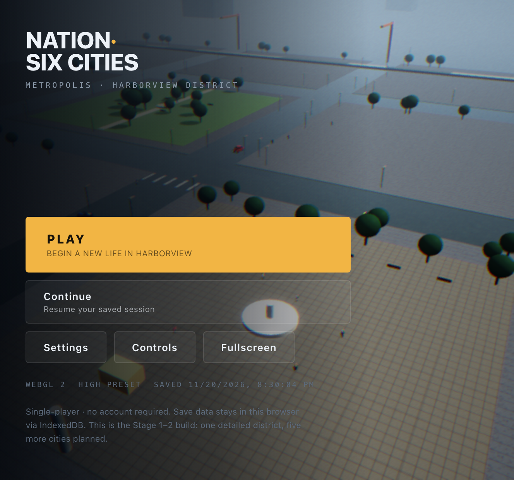
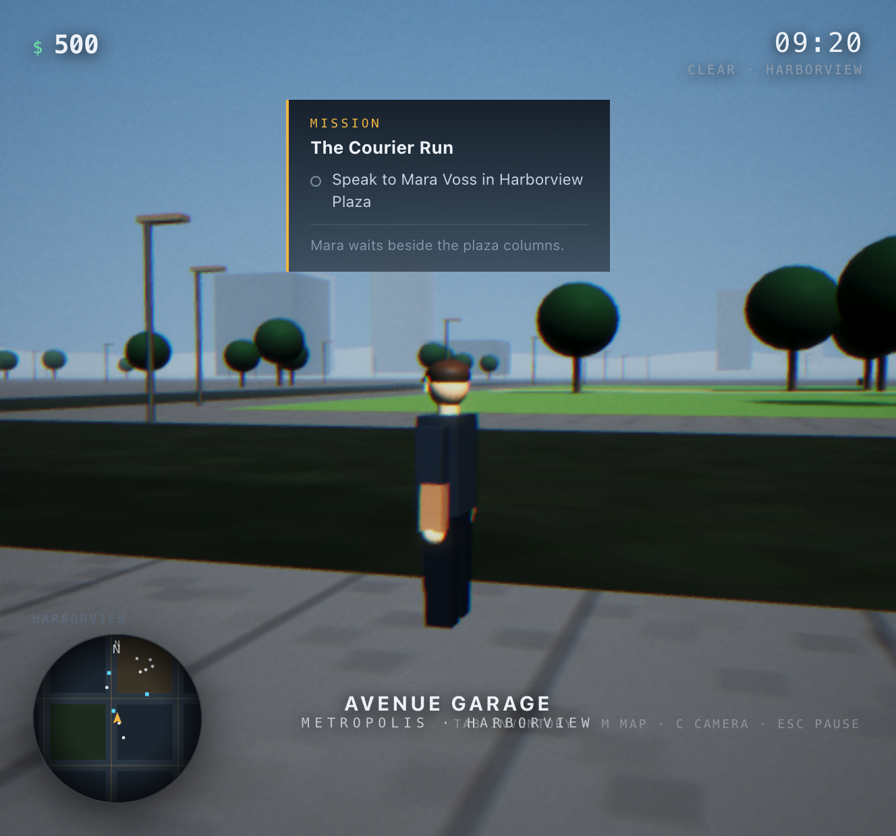
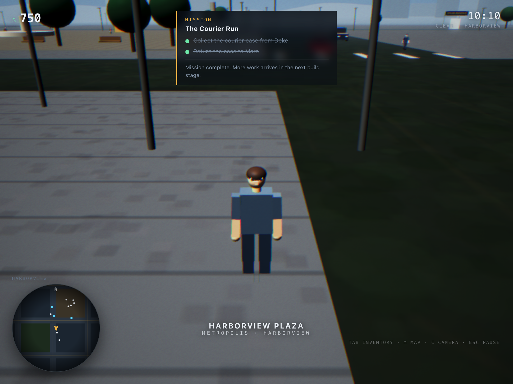
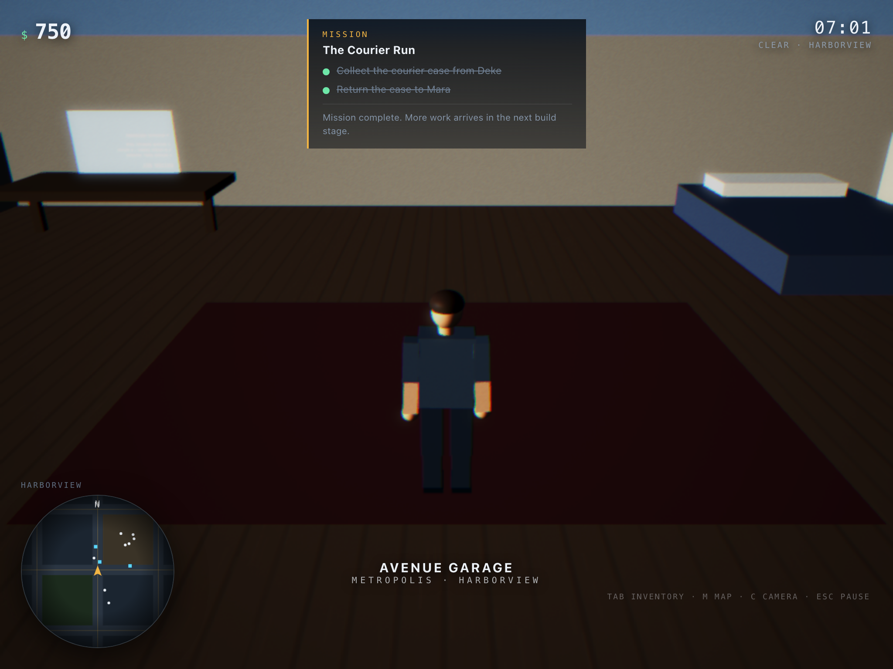
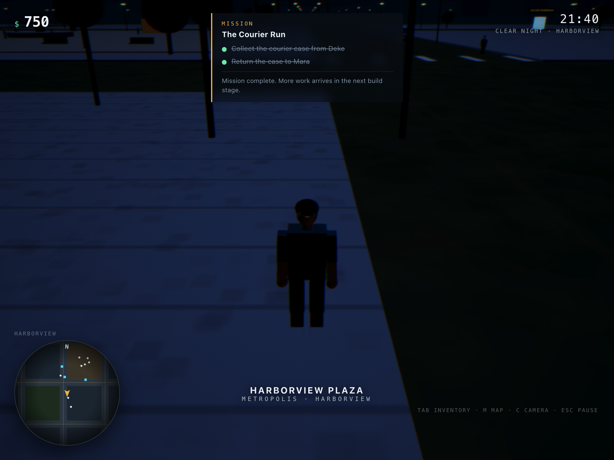
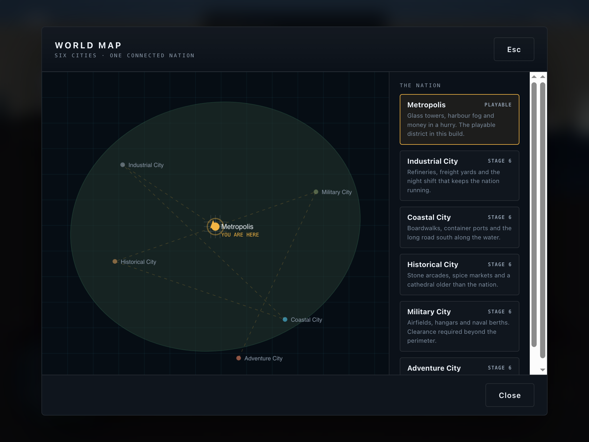

<div align="center">

# OPERA NATION

### Six cities. One connected nation. A life you build yourself.

A browser-native open-world game built with **Babylon.js**, **TypeScript** and **Vite**.
No launcher, no download, no account — open a URL and play.

[](https://raisar2007steve-web.github.io/opera-nation/)




</div>

---

## ▶ Play now

**<https://raisar2007steve-web.github.io/opera-nation/>**

Click **PLAY**, create your resident, then click the world once to lock the mouse. Everything runs
client-side; save data stays in your browser via IndexedDB.

> The Pages build is the production bundle. WebGPU is attempted first and automatically falls back to
> WebGL 2 when the driver cannot upload generated textures (as is common in VMs and older laptops).

---

## What you can actually do in this build

**Stage 1–2: one detailed, playable district — Harborview, Metropolis.**

| | |
|---|---|
| 🏙 **A real neighbourhood** | 16 blocks, 35 buildings with generated facades and lit windows, roads with crossings, sidewalks, streetlights, trees, a plaza with fountain and colonnade, a park, and a harbour wall with cranes. |
| 🚶 **Third-person character** | WASD movement, pointer-lock mouse camera, sprint, jump, collision, wading, procedural avatar with three chase/first-person camera modes. |
| 🧑‍🎨 **Avatar creator** | Skin, hair colour and style, top, trousers, shoes, body build, height, backpack, hat and glasses — carried into gameplay and saved. |
| 🗣 **Eight citizens** | Daily schedules, walking routes, contextual dialogue and low-detail simulation when distant. One of them is an MPD officer. |
| 🚗 **Drivable vehicles** | Kestrel GT and GTS, an MPD cruiser and a Harbor Cab. Enter/exit, acceleration, braking, speed-sensitive steering, suspension bob, headlights and engine audio. |
| 🏠 **Enterable apartment** | Skyline Residences: bed, wardrobe, computer, sleep-to-morning and save-on-sleep. |
| 🎯 **A working mission** | *The Courier Run* — three stages, dialogue, world marker, HUD tracker and a $250 payout. |
| 🚨 **Crime and police** | Steal a car and the wanted level rises; the responding officer closes in, fines you and clears your record. |
| 🗺 **Full interface** | Minimap, six-city world map, inventory and wardrobe, pause menu, settings, dialogue, toasts, money/clock/weather HUD. |
| 💾 **Save and resume** | IndexedDB (with a localStorage mirror) covering character, position, money, inventory, mission stage, clock and owned vehicle. |
| ⚙️ **Scalable graphics** | Low / Medium / High / Ultra presets, adaptive resolution, render distance, mouse sensitivity, volume, invert Y, WebGPU preference, fullscreen. |
| 🌦 **Living world** | Continuous day/night cycle with sun and moon, dynamic shadows, fog, stars, procedural rain, storms and lightning, plus wet-weather ambience. |

<div align="center">



</div>

### Gallery

| Street level | Apartment interior |
| --- | --- |
|  |  |
| **Night, lit windows and streetlights** | **Six-city world map** |
|  |  |

---

## Controls

| Input | Action |
| --- | --- |
| `W` `A` `S` `D` | Move |
| Mouse | Camera look (click the world to lock the pointer) |
| `Shift` | Sprint |
| `Space` | Jump |
| `E` | Interact · enter vehicle · advance dialogue |
| `F` | Exit vehicle |
| `C` | Cycle camera — close chase / far chase / first person |
| `M` | World map |
| `Tab` | Inventory and wardrobe |
| `Esc` | Pause menu |
| Gamepad | Left stick move, right stick camera, triggers accelerate/brake |
| Touch | On-screen stick, buttons and camera drag on mobile |

Bindings for movement, sprint, jump, interact, exit and camera are configurable from **Settings → Controls**.

---

## Run it locally

```bash
npm ci            # exact dependency tree from package-lock.json
npm run dev       # http://localhost:3000
```

Production build and local preview:

```bash
npm run build     # tsc --noEmit + Vite bundle into dist/
npm run preview   # http://localhost:4173
```

`npm run build` must pass before deploying. `dist/` is a fully static site.

---

## Architecture

```
src/
  core/        Game shell, input, settings, event bus, boot and fallback orchestration
  engine/      Renderer (WebGPU → WebGL 2), quality manager, adaptive resolution
  rendering/   Sky and day/night, post-processing pipeline
  terrain/     Procedural ground, coastal shelf, hills
  world/       District generation, colliders, streaming, interiors, interactables
  cities/      Metropolis data and the six-city nation map
  player/      Character controller, orbit/chase camera
  avatar/      Procedural avatar and appearance model
  vehicles/    Arcade vehicle physics, specs and vehicle manager
  npcs/        Schedules, dialogue, distance-based simulation
  missions/    Mission state machine, objectives, rewards
  police/      Wanted level and response
  economy/     Cash, bank, transactions
  inventory/   Items and wearable outfits
  weather/     Rain, storms, lightning, wind, clock
  audio/       Procedural Web Audio ambience and SFX
  ui/          Menu, HUD, settings, map, inventory, dialogue, touch controls
  storage/     IndexedDB saves and settings with a localStorage mirror
public/
  assets/      Asset manifest
```

**Rendering:** a single Babylon scene owns the world; the UI is DOM driven by pushed state, so the
render loop never waits on the interface. WebGPU is probed with a throwaway texture upload before it
is allowed to claim the canvas; a mid-boot failure anywhere in the GPU-heavy phase rebuilds the whole
stack on WebGL 2 with a fresh canvas and remembers the choice.

**Assets:** every mesh, material and texture in this build is generated procedurally at runtime
(Babylon meshes plus canvas `DynamicTexture`s) and every sound is synthesised with Web Audio. No GLB,
KTX2 or recorded audio files are downloaded, which keeps the payload to a single ~6 MB Babylon chunk.
Placeholder art is labelled in the in-game creator and in `public/assets/manifest.json`.

---

## Performance and compatibility

- Frame-time monitoring with adaptive hardware scaling; presets map to distinct shadow, post-FX,
  render-distance and particle budgets.
- 60 FPS on the High preset in this development VM (WebGL 2, software-ish GPU stack).
- WebGPU first, WebGL 2 fallback, pointer lock, fullscreen, responsive layout, DPR-aware canvas.
- Target hardware: any current Chrome, Edge, Firefox or Safari build with WebGL 2. Mobile works with
  touch controls at Low/Medium.

## Deployment

**GitHub Pages** (already enabled): the project publishes `docs/`, a copy of the production build with
`base: "./"` so it works from a sub-path. To refresh it after a change:

```bash
npm run build && rm -rf docs && cp -r dist docs && touch docs/.nojekyll
```

Any static host works too — Netlify, Cloudflare Pages, S3, nginx. Upload `dist/` and serve over HTTPS.
No server code, database or account is required for single-player.

---

## Roadmap

- [x] **Stage 1 — Browser foundation:** loading sequence, canvas, controller, camera, interaction.
- [x] **Stage 2 — First playable city:** Harborview district, roads, buildings, NPCs, vehicles, mission.
- [x] **Stage 3 — Customisation (partial):** avatar creator, wardrobe, inventory, apartment.
- [ ] **Stage 4 — Vehicles:** motorcycles, bicycles, garages, ownership and customisation.
- [ ] **Stage 5 — AI and missions:** full NPC routines, gangs, side quests, pursuit AI.
- [ ] **Stage 6 — Nation expansion:** Industrial, Coastal, Historical, Military and Adventure cities with streaming highways between them.
- [ ] **Stage 7 — Military, air and water:** aircraft, airports, ships, submarines, buoyancy.
- [ ] **Stage 8 — Sports and lifestyle:** gyms, circuits, courts, tournaments.
- [ ] **Stage 9 — Visual production:** authored models, KTX2 textures, skeletal animation, denser audio.

## Known limitations

- Only Harborview is built; the other five cities exist as map data and are not yet walkable.
- Art and audio are procedural placeholders, not authored assets.
- Physics is a custom arcade solver with AABB collision — no ragdolls or vehicle deformation.
- Traffic is scripted along fixed lanes rather than a full navigation mesh.
- WebGPU is used when the device passes the texture-upload probe; otherwise WebGL 2.

---

<div align="center">

**Built with [Babylon.js](https://www.babylonjs.com/) · [TypeScript](https://www.typescriptlang.org/) · [Vite](https://vitejs.dev/)**

Single-player. No account. Everything runs in your browser.

</div>
